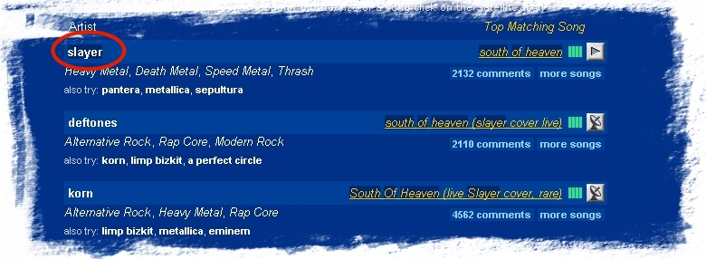
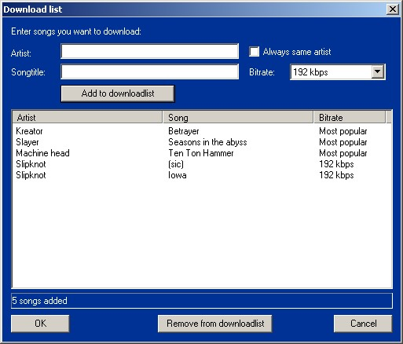
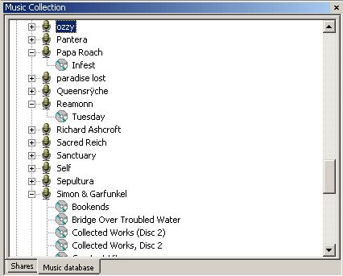
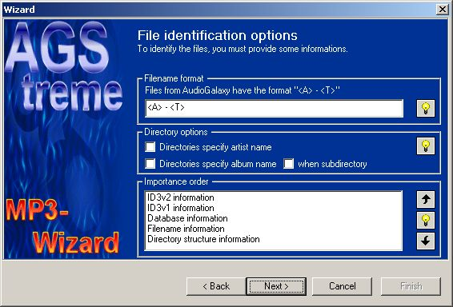
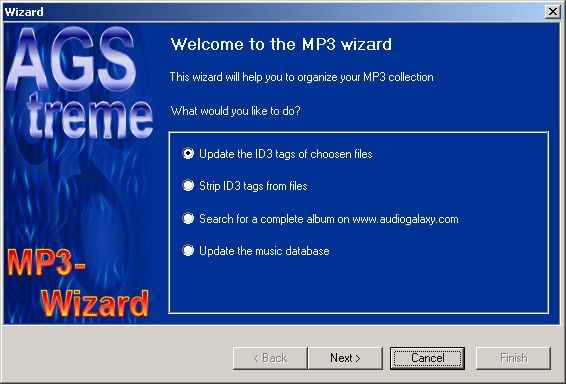
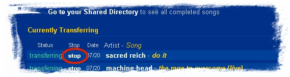

# AGStreme (project name: JAGS)

An alternative Windows client for the **Audiogalaxy** MP3 sharing service,
written in C++ with MFC between July 2001 and April 2002.
The internal project name is **JAGS** (the Visual C++ workspace is `JAGS.dsw`);
the product was released as **AGStreme**, versions 2.0 to 2.22.

> **Historical note.** Audiogalaxy shut down its file-sharing service in
> June 2002. AGStreme talks to that service and to the official Audiogalaxy
> satellite, so the program is non-functional today. The source is archived
> here for historical interest.

## What's that?

From the original `ReadMe.txt`:

> Napster's dead! Long live www.audiogalaxy.com!
>
> Audiogalaxy is a sharing-platform for MP3 files with a HUGE community. You find almost
> every kind of song.
>
> The idea how to handle file up- and downloads is in contrast to other sharing-platforms
> (like Napster (R.I.P.), kazaa, iMesh etc.) a bit different. The whole service is
> web-based. You search your songs on audiogalaxy's homepage and add them to your
> download queue within the webform.
> The client on your PC will then send and receive requested files.
>
> The main reason why I started with AGStreme is the fact, that the original client is not
> really "state of the art" software: too many bugs and too less comfort!
>
> I hope AGStreme will improve the whole audiogalaxy feeling :-)

## Features

Taken from the HTML help in `help/` (`Overview.html`, `ui.html`,
`Musicdatabase.html`, `Thewizard.html`):

- Built-in web browser (`CHtmlView`) with a toolbar for the most important
  Audiogalaxy pages: home, personal page, satellite queue, messages.
- Search-result extractor: songs on an Audiogalaxy search page are parsed and
  shown in a "Song list" tab, from which several songs can be queued at once,
  in a chosen bitrate, or dragged onto a share folder.
- "Download list" dialog to queue many artist/title pairs in one go.
- Drives the official Audiogalaxy satellite (`AGSatellite.exe`): start/stop,
  login, account creation wizard, proxy and SOCKS settings, bandwidth throttle,
  transfer meter, tray icon.
- Explorer-like share manager: shared folders in a tree, MP3 files of the
  selected folder in a list, full drag and drop and context menus, set the
  download directory, add and remove shares.
- MP3 info pane: MPEG header information plus ID3v1 and ID3v2 tag editing
  (view, save, clear, copy between v1 and v2) using id3lib.
- Music database (Microsoft DAO / Access `songs.mdb`): the collection shown
  hierarchically by artist/album, genre and year; reorganise by drag and drop or
  by renaming tree items.
- The "MP3 wizard": mass-tag files from file-name patterns such as `<A> - <T>`,
  strip ID3 tags, find album information on CDDB and search for whole albums on
  Audiogalaxy, (re)build the music database.
- CDDB integration via the Gracenote CDDB control (album look-up, "CDDB search"
  button).
- WinAmp toolbar: start/close WinAmp, previous/next/play/pause/stop, add the
  selected songs to the playlist, clear playlist, generate random playlists from
  the database.
- Dockable panes (Cristi Posea's `CSizingControlBar`) hosting MFC views, tabbed
  views, tip-of-the-day dialog, splash screen.
- NSIS installer script (`jags.nsi`) and HTML Help project (`help/jagshelp.hhp`).

The supported platforms were Windows 2000 and Windows XP (Windows ME with
drawbacks, Windows 9x not supported).

## Screenshots

The images are the ones used in the HTML help (2001).

| | |
|---|---|
|  |  |
|  |  |
|  |  |

More in [`docs/screenshots/`](docs/screenshots/).

## Building

- Microsoft Visual C++ 6.0 with MFC. Open `JAGS.dsw` and build the `JAGS`
  project; the post-build step runs `makensis.exe jags.nsi` to create the
  installer (the path to NSIS in `JAGS.dsp` is the author's `D:\Programme\NSIS`).
- `id3lib/` is vendored, including its own zlib copy; build `id3lib/libprj` and
  `id3lib/zlib/prj` first (the prebuilt `.lib` files were not committed).
- Not included and required to compile and run (see `THIRD_PARTY.md`):
  - Microsoft **DAO 3.5** (the music database uses MFC's `CDaoRecordset`).
  - The **Gracenote CDDB Control SDK** (`CDDBControl.dll`, referenced via
    `#import`). The developer client ID and tag in `CDDBInfo.cpp` and `MainFrm.cpp` have been
    replaced by the placeholders `YOUR_CDDB_CLIENT_ID` and
    `YOUR_CDDB_CLIENT_TAG`.
  - The official **Audiogalaxy satellite** executable, which the program
    launches and controls.

Because the service no longer exists, the build is of archaeological interest
only.

## Repository layout

| Path | Content |
|---|---|
| `*.cpp`, `*.h`, `JAGS.rc`, `res/` | The MFC application. |
| `help/` | HTML Help source (topics, images, `jagshelp.hhp/.hhc/.hhk`). The compiled `jagshelp.chm` is not committed. |
| `id3lib/` | Vendored id3lib 3.8.0pre1 with zlib 1.1.3 (LGPL / zlib licence). |
| `jags.nsi` | NSIS installer script. |
| `filemapping.ags`, `Tips.txt` | Runtime data: file-name pattern mapping and tip-of-the-day texts. |
| `docs/` | Logo and screenshots for this README. |

Some reusable MFC classes written for this program were extracted into the
separate repository <https://github.com/ractive/mfc-views>:
`CTabView` (tabbed doc/view container), `CDockViewWnd` / `CViewBar` (any
`CView` inside a docking control bar) and `CExploTreeView` (Explorer-like shell
folder tree). The copies in this repository are the versions used by
AGStreme 2.22.

## History

| Version | Date | Notes |
|---|---|---|
| 0.7 to 1.1 | July to August 2001 | Released as "JAGS": shares, browser navigation, transfer meter, WinAmp support, drag and drop, lyrics search. |
| 2.0 | September 2001 | Renamed AGStreme; music database, CDDB integration, ID3v2 support, album search. First commit in this repository (source zip as published). |
| 2.1 / 2.12 | October 2001 | Drag and drop from the song list, correct MP3 info. |
| 2.2 / 2.21 | November 2001 | Support for satellite 0.608, gold accounts. |
| 2.22 | April 2002 | CDDB queuing fixed again. Second commit in this repository (working copy, with a few later edits up to January 2004). |

The source was originally published at `http://www.ractive.ch/gpl/AGStreme.html`.

## Notes on this archive

- Excluded from the repository: compiled executables and installers, the
  Gracenote `CDDBControl.dll` and its generated `.tlh`/`.tli` headers, the
  DAO redistributable, the personal `songs.mdb` databases, Paint Shop Pro
  working files, compiled help, Visual C++ IDE state files and CVS metadata.
- Scrubbed: the Gracenote client credentials in `CDDBInfo.cpp` and `MainFrm.cpp`, and a
  commented-out test account (e-mail address, user name, password) in
  `MainFrm.cpp`.
- Source files are Windows-1252 encoded with CRLF line endings and are stored
  byte-for-byte (`.gitattributes` disables text conversion).
- Author: Jean-Pierre Bergamin <james@ractive.ch>.

## Licence

GNU General Public License, version 2 (see `LICENSE` and the original
`LICENSE.TXT`). Third-party components keep their own licences; see
`THIRD_PARTY.md`.
